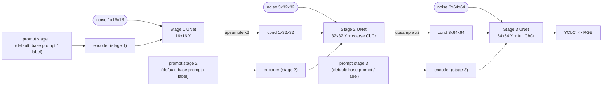

# coarse-to-fine-diffusion

**Prototype:** a text/label-conditioned diffusion cascade that generates **black-and-white first, at low resolution**, and then **adds resolution and colour at each stage**:

```
16x16 grayscale  ->  32x32 grayscale refinement + coarse chroma  ->  64x64 full colour
```

> Status: early research prototype. The code runs end to end on CPU (see [EXPERIMENTS.md](EXPERIMENTS.md)). **No quality claims, no benchmarks.**

## Concept and motivation

Most of an image's structure (layout, shapes, edges) is in its **luminance**, and most of the perceptually important detail can be seen at low resolution. Chroma is usually smoother and can be stored at lower resolution (that is why JPEG subsamples it). This prototype tries out a generation order that follows that idea:

1. **Decide structure cheaply:** generate a tiny 16x16 single-channel (Y) image, with the loss on that miniature only.
2. **Refine, then colour:** each later stage upsamples the previous output, refines luminance at a higher resolution, and adds colour channels (Cb/Cr) according to a configurable **colour schedule**.
3. **Keep the prompt in the loop:** label/text conditioning is fed to **every** stage, so colour and detail decisions stay tied to the prompt. By default every stage sees the same prompt; optionally each stage can get **its own prompt** (see [Per-stage prompts](#per-stage-prompts)), e.g. a short global prompt for the 16x16 composition stage and a more detailed one for texture and colour in stages 2 and 3.

The hope is that splitting the work this way makes each stage's job easier, and lets us study *when* colour should enter the generation process. Whether it actually helps is an open question for this repo.

## Architecture



### Stages (default `c2f.config.default_config()`)

| Stage | Resolution | Generated channels | Chroma loss weight | Chroma target | Conditioning image |
|---|---|---|---|---|---|
| 1 | 16x16 | Y | – | – | none |
| 2 | 32x32 | Y, Cb, Cr | 0.5 | low-pass (avg-pool x4, then upsample) = *coarse chroma* | stage-1 Y, bilinearly upsampled |
| 3 | 64x64 | Y, Cb, Cr | 1.0 | full resolution | stage-2 YCbCr, bilinearly upsampled |

Everything in the table is a field of `StageConfig` (`resolution`, `channels`, `chroma_weight`, `chroma_downsample`, `cond_noise_std`, UNet width), so other schedules, such as a stage that is Y-only at 32x32 or chroma that only appears at 64x64, need no code changes. Images are handled in full-range BT.601 YCbCr, scaled to [-1, 1] so that Cb = Cr = 0 means neutral grey. Lab is on the roadmap.

Each stage is a small UNet (FiLM-style time + condition embedding in every residual block) whose input is `[x_t, upsampled previous output]` concatenated along channels. This is the standard cascaded-diffusion conditioning.

## Losses

Notation: `x_0^(k)` is the target at stage *k* (that stage's channels, at its resolution), `x_t = sqrt(ᾱ_t) x_0 + sqrt(1-ᾱ_t) ε`, `c` is the prompt embedding, and `ε_θ` is the stage UNet.

- **Stage 1:** standard DDPM noise-prediction MSE on 16x16 luminance:
  `L_1 = E_{t,ε} || ε − ε_θ(x_t^(1), t, c) ||²`
- **Stage k > 1:** conditional noise-prediction MSE, conditioned on the upsampled previous-stage image `z = Up(x_0^(k−1)) + σ_aug·n` (ground truth during training, the model's own sample at inference), with per-channel weights:
  `L_k = Σ_ch w_ch · E || ε_ch − ε_θ,ch([x_t^(k), z], t, c) ||² / Σ_ch w_ch`, where `w_Y = 1` and `w_Cb = w_Cr = chroma_weight`.
  `σ_aug` (`cond_noise_std`) is Gaussian conditioning augmentation, following Cascaded Diffusion Models, which reduces the train/test mismatch between ground-truth and sampled conditioning.
- **Condition dropout:** the prompt embedding is replaced by a learned null embedding with probability `cond_drop_prob` (default 0.1), so classifier-free guidance can be added later. Guidance is not implemented yet.
- **Future work (not implemented):** perceptual losses (e.g. LPIPS) on decoded RGB; a cross-stage consistency term, e.g. `|| Down(x̂_0^(k)) − x^(k−1) ||` so a stage cannot contradict the lower-resolution structure it was given; and a colorfulness/chroma-distribution term.

## Conditioning

`c2f/text.py` defines one small interface: an `nn.Module` with `.dim`, `forward(cond) -> (B, dim)` and `null(batch) -> (B, dim)`.

- `LabelEncoder`: an MNIST class embedding (default, `--cond label`).
- `CLIPTextEncoder`: a **frozen pretrained CLIP text encoder** plus a small trainable per-stage adapter (`--cond clip`). This is the recommended mode for text prompts. See [CLIP text encoder](#clip-text-encoder).
- `HashTextEncoder`: a **stub** text encoder (hashed bag-of-words with a trainable `EmbeddingBag`), selected with `--cond text` (alias `--cond stub`). It is *not* a language model. It stays as an offline, dependency-free fallback for tests and CI.

The embedding is projected and added to the timestep embedding in every residual block of **every** stage. Each stage owns its own conditioning module (`Cascade.encoders[k]`), so stages can be trained independently. With CLIP, that module is only a small adapter, and the large frozen backbone is shared.

`--cond label` is still the default of `train.py`. For text prompts, use `--cond clip`. In the Python API, `cond_type="text"` still means the stub: the existing tests and offline CI rely on it, so it was not redirected to CLIP.

### CLIP text encoder

**Dependency.** `--cond clip` needs Hugging Face `transformers` (`>=4.46`; tested with 4.46.3 and 5.20.2):

```bash
pip install -r requirements.txt        # includes transformers
# or: pip install "transformers>=4.46"
```

`--cond label` and `--cond text` do not need `transformers`. If it is missing, or the model cannot be loaded, `train.py` / `sample.py` stop with an error message that says how to fix it (the pip command, the model id, `HF_HUB_OFFLINE`, `--clip-model`, or falling back to `--cond text`).

**Model and download.** The default is `openai/clip-vit-base-patch32`, set with `--clip-model` (a Hugging Face model id **or a local directory**). The first run downloads it from the Hugging Face Hub into the usual HF cache (`~/.cache/huggingface`). The repository is several hundred MB because it also contains the vision tower; only the text tower (about 63M parameters, about 250 MB in fp32) is loaded. Only the tokenizer and text model are loaded, with `CLIPTokenizer` and `CLIPTextModelWithProjection`.

**Offline use.** After one online run, or `hf download openai/clip-vit-base-patch32`, set `HF_HUB_OFFLINE=1`. You can also save the model to a directory (`save_pretrained`) and pass `--clip-model /path/to/dir`. `sample.py --clip-model` overrides the id stored in the checkpoint, for example to point at a local copy.

**Embedding choice.** The prompt embedding is CLIP's **projected, pooled text embedding**, `CLIPTextModelWithProjection(...).text_embeds`: the final-layer-normed hidden state at the EOS token times CLIP's text projection. It is 512-d for ViT-B/32 and is **L2-normalised**. This is the vector CLIP aligns with images, and a single vector per prompt matches the cascade's `(B, dim)` conditioning interface. Prompts are truncated to CLIP's 77 tokens. The per-token hidden states (which cross-attention would need) are not used, because the UNets have no attention layers.

**Shared frozen backbone + per-stage adapters.**

- The backbone (`CLIPTextBackbone`) is loaded **once** and shared by all three stages (`Cascade.text_backbone`, the same object in every `encoders[k].backbone`). It is in `eval()` mode, all its parameters have `requires_grad=False`, and it runs under `torch.no_grad()`.
- It is deliberately *not* an `nn.Module` child. So it is not in `Cascade.parameters()` (the optimizer never sees it) or in `state_dict()`.
- Each stage has its own small trainable adapter, `LayerNorm(512) -> Linear(512, cond_dim)` (about 67k parameters at `cond_dim=128`). `train.py --stage K` trains only stage K's UNet and adapter.
- Per-stage prompts stay separate. Each stage's prompt string is tokenised and run through CLIP **on its own** (batch of one per unique string), then mapped by *that stage's* adapter.

**Null / unconditional embedding.** `null(batch)` is the CLIP embedding of the **empty string `""`**, passed through the stage's adapter. It is a fixed, deterministic CLIP vector, so only the adapter's mapping of it is learned. Condition dropout (`cond_drop_prob`) swaps a stage's embedding for this.

**Determinism and caching.** CLIP features are computed in eval mode without dropout, one prompt at a time, so a prompt's feature does not depend on the rest of the batch. They are cached **per unique prompt string** in an LRU dict of up to 100k entries. Training with templated prompts has very few unique strings: the smoke test needed 11 CLIP forward passes per stage (10 digit prompts + `""`). After that every step is a dict lookup plus the adapter. The cache stores only the frozen features (the adapter runs every step), so it does not change results. The tests check that two calls, and two separately loaded backbones, give bit-identical embeddings on the same machine.

**Checkpoints.** A checkpoint stores `config.cond_type = "clip"`, `config.clip_model`, and an `encoder` entry (`{"type": "clip", "model_id": ..., "embedding": ..., "null_prompt": "", "backbone_saved": false}`). The frozen CLIP weights are **not** saved: `state["encoder"]` holds only the adapter, and a stage checkpoint stays about 3 MB. `sample.py` reads the encoder type and model id from the checkpoint and loads CLIP on startup. Older `label` / `text` checkpoints load unchanged. They simply lack the new fields, and nothing else changed. New checkpoints carry a `clip_model` config field that code from before this change does not know about.

### Per-stage prompts

Each stage can be conditioned on its **own** prompt, encoded separately by that stage's encoder. The intended use: a short global prompt steers the 16x16 luminance stage (composition), and a more detailed prompt steers stages 2 and 3 (texture and colour). For example:

| Stage | Prompt |
|---|---|
| 1 (16x16 Y) | `a handwritten digit seven` (base prompt) |
| 2 (32x32 YCbCr) | `a bold red handwritten seven with thick smooth strokes on a pale blue background` |
| 3 (64x64 YCbCr) | `a bold red handwritten seven with thick smooth strokes on a pale blue background` |

**Fallback rules** (stage numbers are 1-based):

1. If stage *k* has its own prompt, that prompt is used.
2. Otherwise the stage uses the **base prompt**.
3. If there is no base prompt either, the stage uses the labels: the class embedding with `--cond label`, or `"a handwritten digit {name}"` with `--cond text`. This is the original behaviour.

So a base prompt on its own applies to all stages. It gives exactly the same embeddings and samples (for a fixed seed) as passing that prompt to every stage. A call without any prompt arguments behaves exactly as before. Checkpoints are unchanged: the state-dict keys are the same and no parameters were added, so old checkpoints load and new ones load in old code. Condition dropout (`cond_drop_prob`) still swaps a stage's embedding for **that stage's** null embedding (`Cascade.null_embedding(k, B)`), whichever prompt the stage was given.

Prompts are strings, so they need `--cond clip` (or the stub `--cond text`). With `--cond label`, passing a text prompt raises an error. In the Python API, a stage's labels can be overridden with an int or a LongTensor instead.

**Command line:**

```bash
# training: each stage is trained on its own prompt template, filled per image
# placeholders: {digit} -> "seven", {label} -> 7, {color} -> synthetic colour name with --color ("gray" otherwise)
python train.py --stage 1 --cond clip --color --prompt "a handwritten digit {digit}"
python train.py --stage 2 --cond clip --color --prompt-stage2 "a bold {color} handwritten {digit} with thick smooth strokes"
python train.py --stage 3 --cond clip --color --prompt-stage3 "a bold {color} handwritten {digit} with thick smooth strokes"
# stage K uses --prompt-stageK, else --prompt, else the default "a handwritten digit {digit}"

# sampling: --prompt is the base prompt, --prompt-s1/-s2/-s3 override single stages
python sample.py --steps 50 --num-samples 4 \
    --prompt "a handwritten digit seven" \
    --prompt-s2 "a bold red handwritten seven with thick smooth strokes on a pale blue background" \
    --prompt-s3 "a bold red handwritten seven with thick smooth strokes on a pale blue background"
# with --labels, one sample per label; prompts may use {digit}/{label}/{color}, missing ones fall back as above
python sample.py --labels 0 1 2 3 --prompt-s2 "a bold {color} handwritten {digit} with thick smooth strokes"
```

**Python API:**

```python
from c2f import Cascade

model = Cascade(cfg)                     # cfg.cond_type = "clip" (or "text" for the stub)
base = "a handwritten digit seven"
detail = "a bold red handwritten seven with thick smooth strokes on a pale blue background"

# sampling: dict keyed by 1-based stage number, or a per-stage list [s1, s2, s3] (None = fall back)
outs = model.sample(prompt=base, stage_prompts={2: detail, 3: detail}, num_samples=4, steps=50)
outs = model.sample(stage_prompts=[base, detail, detail], num_samples=4)
outs = model.sample(prompt=base, num_samples=4)          # base prompt on every stage
outs = model.sample(labels)                              # original call, unchanged

# training: each prompt is a str (broadcast to the batch) or a list of B strings
loss = model.stage_loss(k, x, labels, stage_prompts={k + 1: prompts_for_batch})
loss = model.stage_loss(k, x, labels)                    # original call, unchanged

# inspect what a stage receives and its embedding
model.stage_condition(1, prompt=base, stage_prompts={2: detail}, batch=4)  # -> stage-2 prompts
model.encode_stage(1, prompt=base, stage_prompts={2: detail}, batch=4)     # -> (4, cond_dim)
model.null_embedding(1, 4)                                                  # unconditional embedding
```

> **Caveat:** with `--cond clip`, each stage's prompt is a real CLIP text embedding, so similar wordings map to nearby vectors. For example, the cosine similarity is 0.97 between "a photo of a red car" and "a picture of a red automobile", against 0.68 to "a bowl of soup". Whether the tiny UNets actually *follow* those prompts has **not** been tested: only a plumbing smoke test has been run, and there are no quality results. With the stub `--cond text` (`HashTextEncoder`), prompts are bags of hashed words with no meaning, and a stage only responds to wording it was trained on. Use it for offline tests only.

## Data

- `mnist` (default): grayscale MNIST resized to 64x64. Chroma is neutral, so the colour stages learn "no colour", which makes them effectively a no-op.
- `mnist --color`: **synthetic-colourised MNIST**. Each digit class gets a fixed foreground colour on a slightly tinted random background, so colour is predictable from the label and the chroma stages have something to learn.

## Install

```bash
python -m venv .venv && source .venv/bin/activate
pip install torch torchvision --index-url https://download.pytorch.org/whl/cpu   # or a CUDA build
pip install -r requirements.txt   # torch(vision), pytest, transformers (for --cond clip)
pytest -q tests        # CPU, a few seconds; CLIP tests download the model on first run, or skip
                       # with a reason if transformers / the model is unavailable (e.g. HF_HUB_OFFLINE=1)
```

## Run

Train each stage independently. MNIST is downloaded to `./data` on first use, and checkpoints go to `./checkpoints/stageK.pt`, with the loss history in `stageK_losses.json`.

```bash
python train.py --stage 1 --steps 5000 --color
python train.py --stage 2 --steps 5000 --color
python train.py --stage 3 --steps 5000 --color
# options: --cond {label,clip,text}, --clip-model ID_OR_PATH, --subset N, --batch-size, --lr, --ckpt-dir,
#          --prompt / --prompt-stage{1,2,3} (text only, see "Per-stage prompts")
```

Sample the full cascade. Rows are stages 1..3, each shown at the final resolution:

```bash
python sample.py --labels 0 1 2 3 4 5 6 7 8 9 --steps 50 --out samples.png
```

Quick smoke test (what was actually run, see EXPERIMENTS.md):

```bash
for s in 1 2 3; do python train.py --stage $s --steps 20 --batch-size 16 --subset 512 --color; done
python sample.py --steps 5 --labels 0 1 2 3
```

CLIP plumbing smoke test (temporary checkpoint dir, downloads CLIP on first run):

```bash
T=$(mktemp -d)
python train.py --stage 1 --steps 5 --batch-size 16 --subset 64 --color --cond clip --prompt "a handwritten digit {digit}" --ckpt-dir $T
python train.py --stage 2 --steps 5 --batch-size 16 --subset 64 --color --cond clip --prompt-stage2 "a bold {color} handwritten {digit} with thick smooth strokes" --ckpt-dir $T
python train.py --stage 3 --steps 5 --batch-size 16 --subset 64 --color --cond clip --prompt-stage3 "a bold {color} handwritten {digit} with thick smooth strokes" --ckpt-dir $T
python sample.py --ckpt-dir $T --steps 3 --num-samples 4 --prompt "a handwritten digit seven" \
    --prompt-s2 "a bold red handwritten seven with thick smooth strokes on a pale blue background" \
    --prompt-s3 "a bold red handwritten seven with thick smooth strokes on a pale blue background" --out $T/samples.png
```

## Layout

```
c2f/config.py     StageConfig / CascadeConfig, colour schedule
c2f/unet.py       small time+condition UNet with configurable in/out channels
c2f/diffusion.py  linear-beta DDPM, weighted ε-MSE loss, DDIM sampler
c2f/cascade.py    Cascade: per-stage UNets + encoders, stage losses, full sampling
c2f/color.py      RGB <-> YCbCr helpers
c2f/text.py       label encoder, frozen CLIP text encoder + adapters, hashed text stub, per-stage prompt helpers
c2f/data.py       MNIST (gray / synthetic colour)
train.py          train one stage
sample.py         sample the cascade
tests/            shape, per-stage prompt and CLIP tests (run in CI; CLIP-model tests skip offline)
```

## Roadmap

- [ ] Real training runs on MNIST (gray and synthetic colour) with logged curves and samples
- [ ] Classifier-free guidance at sampling time
- [ ] Lab colour space option; alternative colour schedules (e.g. chroma only at the last stage)
- [ ] Cross-stage consistency loss and perceptual loss
- [x] Plug in a frozen CLIP text encoder (`--cond clip`; plumbing tested, no training results yet)
- [ ] T5 encoder option; per-token embeddings + cross-attention
- [x] Per-stage prompts (interface only; needs a real text encoder to be meaningful)
- [ ] Richer datasets: CelebA / FFHQ (faces), landscapes
- [ ] Compare against a single-stage 64x64 colour baseline at equal compute
- [ ] Optional joint fine-tuning of all stages

## Limitations (honest)

- This is a **prototype**. Only a smoke test has been run: a few steps per stage, which produces noise. There are **no results, metrics, or quality claims**.
- The UNets are tiny (about 0.7M parameters per stage) and have no attention layers.
- Text conditioning now uses a real frozen CLIP encoder (`--cond clip`), but nothing has been trained with it beyond a few-step smoke test. MNIST prompts are templated from the labels, so they carry no more information than the labels. The stub (`--cond text`) remains for offline use.
- Synthetic colourisation is trivially predictable from the label, so it tests the plumbing, not real colourisation ability.
- Stages are trained independently on ground-truth low-res inputs. Exposure bias at inference is only mitigated by conditioning noise augmentation.

## Related work

- Denton et al., *Deep Generative Image Models using a Laplacian Pyramid of Adversarial Networks* (LAPGAN), 2015. https://arxiv.org/abs/1506.05751
- Karras et al., *Progressive Growing of GANs for Improved Quality, Stability, and Variation*, ICLR 2018. https://arxiv.org/abs/1710.10196
- Ho et al., *Cascaded Diffusion Models for High Fidelity Image Generation*, 2021. https://arxiv.org/abs/2106.15282 (cascade conditioning on upsampled low-res images; conditioning augmentation)
- Saharia et al., *Photorealistic Text-to-Image Diffusion Models with Deep Language Understanding* (Imagen), 2022. https://arxiv.org/abs/2205.11487 (text-conditioned cascade, frozen T5 conditioning all stages)
- Gu et al., *Matryoshka Diffusion Models*, 2023. https://arxiv.org/abs/2310.15111 (joint multi-resolution diffusion)
- Tian et al., *Visual Autoregressive Modeling: Scalable Image Generation via Next-Scale Prediction* (VAR), 2024. https://arxiv.org/abs/2404.02905
- Zhang et al., *Colorful Image Colorization*, 2016. https://arxiv.org/abs/1603.08511 (predicting chroma given luminance)

## License

MIT, see [LICENSE](LICENSE).
