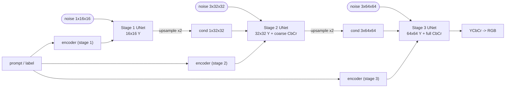

# coarse-to-fine-diffusion

**Prototype:** a text/label-conditioned diffusion cascade that generates **black-and-white first, at low resolution**, and then **adds resolution and colour at each stage**:

```
16x16 grayscale  ->  32x32 grayscale refinement + coarse chroma  ->  64x64 full colour
```

> Status: early research prototype. The code runs end to end on CPU (see [EXPERIMENTS.md](EXPERIMENTS.md)). **No quality claims, no benchmarks.**

## Concept and motivation

Most of an image's structure (layout, shapes, edges) is in its **luminance**, and most of the perceptually important detail can be seen at low resolution. Chroma is usually smoother and can be stored at lower resolution (that is why JPEG subsamples it). This prototype tries out a generation order that follows that idea:

1. **Decide structure cheaply:** generate a tiny 16x16 single-channel (Y) image, with the loss on that miniature only.
2. **Refine, then colour:** each later stage upsamples the previous output, refines luminance at a higher resolution, and adds colour channels (Cb/Cr) according to a configurable **colour schedule**.
3. **Keep the prompt in the loop:** the same label/text conditioning is fed to **every** stage, so colour and detail decisions stay tied to the prompt.

The hope is that splitting the work this way makes each stage's job easier, and lets us study *when* colour should enter the generation process. Whether it actually helps is an open question for this repo.

## Architecture



### Stages (default `c2f.config.default_config()`)

| Stage | Resolution | Generated channels | Chroma loss weight | Chroma target | Conditioning image |
|---|---|---|---|---|---|
| 1 | 16x16 | Y | – | – | none |
| 2 | 32x32 | Y, Cb, Cr | 0.5 | low-pass (avg-pool x4, then upsample) = *coarse chroma* | stage-1 Y, bilinearly upsampled |
| 3 | 64x64 | Y, Cb, Cr | 1.0 | full resolution | stage-2 YCbCr, bilinearly upsampled |

Everything in the table is a field of `StageConfig` (`resolution`, `channels`, `chroma_weight`, `chroma_downsample`, `cond_noise_std`, UNet width), so other schedules, such as a stage that is Y-only at 32x32 or chroma that only appears at 64x64, need no code changes. Images are handled in full-range BT.601 YCbCr, scaled to [-1, 1] so that Cb = Cr = 0 means neutral grey. Lab is on the roadmap.

Each stage is a small UNet (FiLM-style time + condition embedding in every residual block) whose input is `[x_t, upsampled previous output]` concatenated along channels. This is the standard cascaded-diffusion conditioning.

## Losses

Notation: `x_0^(k)` is the target at stage *k* (that stage's channels, at its resolution), `x_t = sqrt(ᾱ_t) x_0 + sqrt(1-ᾱ_t) ε`, `c` is the prompt embedding, and `ε_θ` is the stage UNet.

- **Stage 1:** standard DDPM noise-prediction MSE on 16x16 luminance:
  `L_1 = E_{t,ε} || ε − ε_θ(x_t^(1), t, c) ||²`
- **Stage k > 1:** conditional noise-prediction MSE, conditioned on the upsampled previous-stage image `z = Up(x_0^(k−1)) + σ_aug·n` (ground truth during training, the model's own sample at inference), with per-channel weights:
  `L_k = Σ_ch w_ch · E || ε_ch − ε_θ,ch([x_t^(k), z], t, c) ||² / Σ_ch w_ch`, where `w_Y = 1` and `w_Cb = w_Cr = chroma_weight`.
  `σ_aug` (`cond_noise_std`) is Gaussian conditioning augmentation, following Cascaded Diffusion Models, which reduces the train/test mismatch between ground-truth and sampled conditioning.
- **Condition dropout:** the prompt embedding is replaced by a learned null embedding with probability `cond_drop_prob` (default 0.1), so classifier-free guidance can be added later. Guidance is not implemented yet.
- **Future work (not implemented):** perceptual losses (e.g. LPIPS) on decoded RGB; a cross-stage consistency term, e.g. `|| Down(x̂_0^(k)) − x^(k−1) ||` so a stage cannot contradict the lower-resolution structure it was given; and a colorfulness/chroma-distribution term.

## Conditioning

`c2f/text.py` defines one small interface: an `nn.Module` with `.dim`, `forward(cond) -> (B, dim)` and `null(batch) -> (B, dim)`.

- `LabelEncoder`: an MNIST class embedding (default, `--cond label`).
- `HashTextEncoder`: a **stub** text encoder (hashed bag-of-words with a trainable `EmbeddingBag`), fed prompts like `"a handwritten digit seven"` (`--cond text`). It is *not* a language model. It only exercises the string-prompt path.
- `PretrainedTextEncoder`: a placeholder for a frozen CLIP or T5 encoder. Its intended shape is described in the docstring, but it raises `NotImplementedError` for now.

The embedding is projected and added to the timestep embedding in every residual block of **every** stage. Each stage currently owns its own small trainable encoder, so stages can be trained independently. A frozen pretrained encoder could be shared across stages.

## Data

- `mnist` (default): grayscale MNIST resized to 64x64. Chroma is neutral, so the colour stages learn "no colour", which makes them effectively a no-op.
- `mnist --color`: **synthetic-colourised MNIST**. Each digit class gets a fixed foreground colour on a slightly tinted random background, so colour is predictable from the label and the chroma stages have something to learn.

## Install

```bash
python -m venv .venv && source .venv/bin/activate
pip install torch torchvision --index-url https://download.pytorch.org/whl/cpu   # or a CUDA build
pip install -r requirements.txt
pytest -q tests        # shape tests, CPU, a few seconds
```

## Run

Train each stage independently. MNIST is downloaded to `./data` on first use, and checkpoints go to `./checkpoints/stageK.pt`, with the loss history in `stageK_losses.json`.

```bash
python train.py --stage 1 --steps 5000 --color
python train.py --stage 2 --steps 5000 --color
python train.py --stage 3 --steps 5000 --color
# options: --cond text, --subset N, --batch-size, --lr, --ckpt-dir
```

Sample the full cascade. Rows are stages 1..3, each shown at the final resolution:

```bash
python sample.py --labels 0 1 2 3 4 5 6 7 8 9 --steps 50 --out samples.png
```

Quick smoke test (what was actually run, see EXPERIMENTS.md):

```bash
for s in 1 2 3; do python train.py --stage $s --steps 20 --batch-size 16 --subset 512 --color; done
python sample.py --steps 5 --labels 0 1 2 3
```

## Layout

```
c2f/config.py     StageConfig / CascadeConfig, colour schedule
c2f/unet.py       small time+condition UNet with configurable in/out channels
c2f/diffusion.py  linear-beta DDPM, weighted ε-MSE loss, DDIM sampler
c2f/cascade.py    Cascade: per-stage UNets + encoders, stage losses, full sampling
c2f/color.py      RGB <-> YCbCr helpers
c2f/text.py       label encoder, hashed text stub, CLIP/T5 placeholder
c2f/data.py       MNIST (gray / synthetic colour)
train.py          train one stage
sample.py         sample the cascade
tests/            shape tests (run in CI)
```

## Roadmap

- [ ] Real training runs on MNIST (gray and synthetic colour) with logged curves and samples
- [ ] Classifier-free guidance at sampling time
- [ ] Lab colour space option; alternative colour schedules (e.g. chroma only at the last stage)
- [ ] Cross-stage consistency loss and perceptual loss
- [ ] Plug in a frozen CLIP or T5 text encoder
- [ ] Richer datasets: CelebA / FFHQ (faces), landscapes
- [ ] Compare against a single-stage 64x64 colour baseline at equal compute
- [ ] Optional joint fine-tuning of all stages

## Limitations (honest)

- This is a **prototype**. Only a smoke test has been run: a few steps per stage, which produces noise. There are **no results, metrics, or quality claims**.
- The UNets are tiny (about 0.7M parameters per stage) and have no attention layers.
- The text encoder is a stub. MNIST labels are the only meaningful conditioning.
- Synthetic colourisation is trivially predictable from the label, so it tests the plumbing, not real colourisation ability.
- Stages are trained independently on ground-truth low-res inputs. Exposure bias at inference is only mitigated by conditioning noise augmentation.

## Related work

- Denton et al., *Deep Generative Image Models using a Laplacian Pyramid of Adversarial Networks* (LAPGAN), 2015. https://arxiv.org/abs/1506.05751
- Karras et al., *Progressive Growing of GANs for Improved Quality, Stability, and Variation*, ICLR 2018. https://arxiv.org/abs/1710.10196
- Ho et al., *Cascaded Diffusion Models for High Fidelity Image Generation*, 2021. https://arxiv.org/abs/2106.15282 (cascade conditioning on upsampled low-res images; conditioning augmentation)
- Saharia et al., *Photorealistic Text-to-Image Diffusion Models with Deep Language Understanding* (Imagen), 2022. https://arxiv.org/abs/2205.11487 (text-conditioned cascade, frozen T5 conditioning all stages)
- Gu et al., *Matryoshka Diffusion Models*, 2023. https://arxiv.org/abs/2310.15111 (joint multi-resolution diffusion)
- Tian et al., *Visual Autoregressive Modeling: Scalable Image Generation via Next-Scale Prediction* (VAR), 2024. https://arxiv.org/abs/2404.02905
- Zhang et al., *Colorful Image Colorization*, 2016. https://arxiv.org/abs/1603.08511 (predicting chroma given luminance)

## License

MIT, see [LICENSE](LICENSE).
